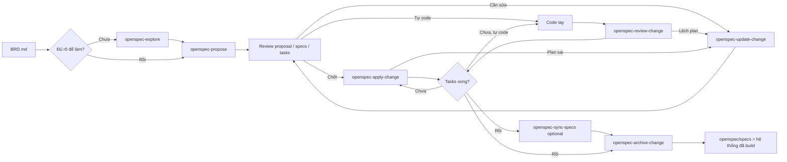

# Flow làm việc nhóm — BRD + OpenSpec

| Thuộc tính | Giá trị |
|---|---|
| Phiên bản | 1.6 |
| Ngày | 2026-11-23 |
| Áp dụng cho | Dự án `kasio` và các dự án dùng chung quy trình |
| Tài liệu liên quan | `docs/business-requirements/BRD.md` (D-14, mục 1.7) |
| Lịch sử | 1.0 (2026-11-21) quy trình baseline; 1.1 (2026-11-22) thêm tech stack; 1.2 (2026-11-22) CQRS GET từ MongoDB + audit Staff; 1.3 (2026-11-22) audit mọi actor đã xác thực, Owner xem audit của mình; 1.4 (2026-11-22) CAP outbox cho đồng bộ write→read; 1.5 (2026-11-22) thêm `openspec-review-change` cho luồng tự code; 1.6 (2026-11-23) web responsive only (bỏ mobile); luồng 2 repo docs↔code, review cross-repo, change scaffolding |
| Mục đích | Thống nhất cách chuyển yêu cầu nghiệp vụ thành change, code, review và archive |

> **BRD là nguồn sự thật về sản phẩm. OpenSpec là nguồn sự thật về change đang làm và spec đã build.**
> Tài liệu này không thay thế BRD; nó quy định cách team làm việc với BRD.

---

## 1. Nguyên tắc

1. **Không code trước khi có change plan được duyệt.** Ngoại lệ duy nhất là hotfix P0 có Tech Lead duyệt, và phải backfill change trong 24 giờ.
2. **Một change = một capability quan sát được.** Không tạo change `add-whole-saas`.
3. **`tasks.md` là nguồn tiến độ duy nhất.** Không có checklist ẩn trong chat/board.
4. **Main spec là hệ thống đã build.** Sau archive, `openspec/specs/` phải phản ánh đúng code.
5. **Tenant isolation, authorization và audit là gate cứng.** Thiếu test tương ứng thì không merge.
6. **Không mở scope trong lúc apply.** Ý mới → tạo change mới, không nhét vào change hiện tại.
7. **Plan là markdown.** Sửa tay được; nhưng nếu sửa làm lệch các artifact khác, dùng `openspec-update-change`.
8. **Hai repo, một nguồn plan.** Plan (`openspec/`) nằm ở repo docs; code nằm ở repo code. `tasks.md` là cầu nối duy nhất: agent tick ở repo docs, code ở repo code, không tạo `openspec/` thứ hai.

---

## 2. Cài đặt và cấu trúc

### 2.1 Mỗi máy thành viên

Cài CLI một lần:

```bash
curl -fsSL https://openspec.dev/cli/install.sh | sh
openspec --version
```

Cài skill global cho agent đang dùng. Ví dụ với omp:

```bash
cd /path/to/kasio
openspec init --tools oh-my-pi --scope global --language vi
```

Với agent khác, thay `oh-my-pi` bằng ID tương ứng (`opencode`, `claude`, `cursor`, ...):

```bash
openspec init --tools <agent-id> --scope global --language vi
```

Kiểm tra:

```bash
openspec list
omp skill list --json | jq -r '.skills[] | select(.name|startswith("openspec")) | .name'
```

Skill nằm ở `~/.agents/skills/`, dùng cho **mọi project** trên máy. Không commit thư mục skill global vào repo. Skill tự viết của team (ví dụ `openspec-review-change`) cũng đặt ở `~/.agents/skills/<name>/SKILL.md`.

Cập nhật skill định kỳ:

```bash
openspec update
```

### 2.2 Plan một repo, code hai repo

Plan nằm ở repo docs; code tách BE và FE. Mặc định dự án `kasio`:

```text
kasio/
├── brd/                          # repo docs — openspec root
│   ├── docs/business-requirements/BRD.md
│   ├── docs/process/Flow.md
│   └── openspec/                 # config.yaml, specs/, changes/
├── api/                          # repo BE — không có openspec/
│   └── src/                      # ASP.NET Core
└── ui/                           # repo FE — không có openspec/ (chưa tạo)
    └── src/                      # Next.js
```

| Repo | Chứa | Lệnh chạy ở đây |
|---|---|---|
| `brd` | BRD, Flow, `openspec/` | `openspec ...`, `openspec validate --all` |
| `api` | Backend ASP.NET Core | `dotnet build/test`, `git` |
| `ui` | Frontend Next.js (chưa tạo) | `npm`/`pnpm` build/test, `git` |

Quy tắc:

- Mọi lệnh `openspec ...` chạy với cwd = `brd` (hoặc `--store <id>`).
- Mọi lệnh git/build/test chạy với cwd = repo code tương ứng, hoặc `git -C <code-repo> ...`.
- Không `openspec init` trong `api` hay `ui`. Nếu repo code đã có `openspec/`, luôn truyền `--planning-root <brd>` để không phân giải sai root.
- Một change có thể chạm cả BE và FE — vẫn là một change. Review chạy **một lượt cho mỗi repo**, giới hạn task của repo đó, và luôn truyền planning root:
  BE (cwd `api`): `/skill:openspec-review-change <change> review 1.1-1.4 --planning-root ~/workspace/kasio/brd`
  FE (cwd `ui`): `/skill:openspec-review-change <change> review 1.5-1.8 --planning-root ~/workspace/kasio/brd`.
- Task của repo không được review trong lượt đó không bị tick; chúng chỉ được đếm là out-of-scope.
- `ui` chưa tạo: mọi change hiện tại chỉ chạm `api`; phần FE ghi vào Out of Scope cho đến khi repo tồn tại.
- Nhiều dự án trên một máy: truyền `--planning-root` mỗi lần, không đặt `defaultStore` global.

### 2.3 Repo docs mới

Tạo cấu trúc OpenSpec cho repo docs, không cài lại skill:

```bash
cd /path/to/docs-repo
openspec init --tools none --language vi
openspec validate --all
```

Giữ `openspec/` + `docs/`; không cần `src/` ở repo docs. CI của repo docs chạy `openspec validate --all`.

### 2.4 Cấu hình project

`openspec/config.yaml` nên ghi rõ context để mọi agent đọc cùng một luật:

```yaml
schema: spec-driven

context: |
  Language: vi
  All artifacts must be written in vi.
  Keep OpenSpec structural headings and SHALL/MUST keywords in English.

  Source of truth: docs/business-requirements/BRD.md
  Read BRD before proposing a change.

  Non-negotiable:
  - Every tenant-scoped endpoint has a cross-tenant negative test.
  - Sensitive actions write an audit event.
  - Every authenticated action is audited; Owner can view own and Staff activity log.
  - All domain GET/query APIs read from MongoDB read model; commands write PostgreSQL.
  - No online payment, billing, group chat, offline mode, or auto image comparison.
  - One change = one observable capability.

  Tech stack (BRD D-14, mục 1.7):
  - Backend: C# ASP.NET Core, DDD + CQRS.
  - Write DB: PostgreSQL (source of truth, business constraints).
  - Read DB: MongoDB (projection only, rebuildable).
  - Sync write→read: CAP (.NET) transactional outbox + event bus.
  - Background jobs: Hangfire, idempotent.
  - Web: Next.js + Tailwind CSS + GSAP; một web app responsive cho mọi actor.
```

Không đưa secret, token hay thông tin khách hàng vào `config.yaml`.

### 2.5 Tech stack đã chốt

Tech stack không còn là câu hỏi mở. Mọi change bám theo bảng dưới; đổi stack phải tạo `OD-*` mới và ADR, không tự ý đổi trong lúc apply.

| Lớp | Công nghệ | Ghi chú cho change |
|---|---|---|
| Backend | C# / ASP.NET Core | DDD layering: Domain, Application, Infrastructure, Api |
| Kiến trúc | DDD + CQRS | Command ghi PostgreSQL; mọi domain GET/query đọc MongoDB; không trộn |
| Write DB | PostgreSQL | Nguồn sự thật; unique/partial index; EF Core global query filter |
| Read DB | MongoDB | Projection rebuild được; mọi document tenant-scoped có `tenantId` |
| Sync write→read | CAP (.NET) | Transactional outbox + event bus; publish sau commit; at-least-once; projection idempotent; transport chốt ở Sprint 0 |
| Background job | Hangfire | Worker riêng; job idempotent; không giữ transaction dài |
| Web | Next.js + Tailwind CSS + GSAP | Một web app responsive cho Owner/Staff/Renter/Seeker/Platform Admin; GSAP cho animation/transition |

Quy tắc:

- `design.md` của change chạm dữ liệu phải nêu: aggregate/command nào, CAP outbox/projection nào, job nào.
- Task CQRS đi theo thứ tự: write schema → domain → command handler → CAP outbox → projection → query API → UI.
- Mọi domain GET/query handler chỉ đọc MongoDB; auth/session/permission/idempotency là ngoại lệ hạ tầng.
- Test cross-tenant phải phủ cả endpoint đọc từ MongoDB.
- Không thêm công nghệ mới (message broker/cache/search engine) ngoài transport đã chốt cho CAP nếu BRD chưa có quyết định; đề xuất bằng change/ADR riêng.
- UI chỉ làm trên web responsive (viewport 360 px → desktop); không thêm app native/React Native trừ khi BRD đổi D-14.

---

## 3. Bảy skill và thứ tự dùng

### 3.1 Vai trò từng skill

| Thứ tự | Skill | Làm gì | Sửa code? | Bắt buộc? |
|---|---|---|---|---|
| 0 | `openspec-explore` | Suy nghĩ, so sánh phương án, làm rõ yêu cầu | Không | Không |
| 1 | `openspec-propose` | Tạo change + `proposal.md`, `specs/`, `design.md`, `tasks.md` | Không | Có |
| 2 | `openspec-update-change` | Sửa plan cho khớp nhau | Không | Khi cần |
| 3 | `openspec-apply-change` | Implement từng task, tick `tasks.md` | Có | Chỉ khi code cùng repo với plan; setup 2 repo thì tự code + `review-change` |
| 4 | `openspec-review-change` | Đối chiếu code tự viết với artifact, chạy check, tick task có bằng chứng; làm nốt task nhỏ hoặc viết test scenario | Có (mode `finish`/`tests`) | Khi tự code |
| 5 | `openspec-sync-specs` | Merge delta spec vào main spec, không archive | Không | Khi cần |
| 6 | `openspec-archive-change` | Đóng change, archive, merge spec | Không | Có |

**Không gọi cả 7 skill tuần tự.** Happy path chỉ có:

```text
explore? → propose → review plan → (apply | tự code → review-change) → archive
```

`update-change` và `sync-specs` là nhánh xử lý, không phải bước bắt buộc.

### 3.2 Happy path



Khi plan và code ở các repo khác nhau (mục 2.2): `explore`/`propose`/`update-change`/`sync-specs`/`archive` chạy ở `brd`; code và `review-change` chạy ở `api`/`ui` với `--planning-root <brd>`, mỗi repo một lượt. `apply-change` chỉ dùng khi code nằm cùng repo với plan.

### 3.3 Cách gọi trong omp

Trong omp, gõ `/skill:` rồi chọn skill, hoặc dùng trực tiếp:

```text
/skill:openspec-explore "..."
/skill:openspec-propose add-tenant-auth-foundation
/skill:openspec-update-change add-tenant-auth-foundation
/skill:openspec-apply-change add-tenant-auth-foundation
/skill:openspec-review-change add-tenant-auth-foundation
/skill:openspec-review-change add-tenant-auth-foundation tests
/skill:openspec-review-change add-tenant-auth-foundation finish
/skill:openspec-sync-specs add-tenant-auth-foundation
/skill:openspec-archive-change add-tenant-auth-foundation
```

Từ repo code, luôn truyền planning root:

```text
/skill:openspec-review-change add-tenant-auth-foundation --planning-root ~/workspace/kasio/brd
/skill:openspec-review-change add-tenant-auth-foundation finish 1.2-1.5 --planning-root ~/workspace/kasio/brd
```

Agent khác có thể dùng `/openspec-propose`, hoặc mô tả bằng lời:

```text
Dùng openspec-propose để tạo change add-tenant-auth-foundation.
```

### 3.4 Tự code rồi review (không dùng apply)

`apply` là tùy chọn, không bắt buộc — và không dùng được khi plan và code ở các repo khác nhau. Tự code là cách hợp lệ, miễn là trước khi archive có bước đối chiếu code với artifact.

`openspec-review-change` là skill **global** (`~/.agents/skills/openspec-review-change/SKILL.md`), không commit vào repo; máy mới chỉ cần copy thư mục skill vào `~/.agents/skills/`. Skill chạy từ repo code và nhận:

| Tham số | Ý nghĩa |
|---|---|
| `<change>` | Tên change trong repo docs; bỏ trống nếu chỉ có một change active |
| `mode` | `review` (mặc định), `tests`, `finish` |
| `tasks` | `3`, `1.2`, `3-5`, `3,4`; bỏ trống = toàn bộ `tasks.md` |
| `code-repo` | Đường dẫn repo code cho lượt này (`../api`, `../ui`); mặc định cwd. Token trỏ tới thư mục tồn tại được đọc là tham số này |
| `--planning-root <path>` | Repo docs chứa `openspec/`; bắt buộc khi cwd là repo code |
| `--base <ref>` | Base của diff; mặc định upstream branch → `main`/`master`/`develop` |

Skill lấy baseline = **branch hiện tại** của repo code: commit từ `merge-base <base> HEAD` đến `HEAD`, cộng phần chưa commit và untracked. Vì vậy code trên branch riêng (`change/<name>`), không code thẳng trên `main` (diff sẽ rỗng). Skill chỉ đọc branch đang đứng, không switch/stash/reset.

| Mode | Ghi gì | Dùng khi |
|---|---|---|
| `review` (mặc định) | Chỉ tick `tasks.md` | Code xong phần chính, muốn biết đúng/thiếu gì |
| `tests` | Thêm test + tick task test | Spec scenario chưa có test |
| `finish` | Code + test + tick | Còn task nhỏ, rõ ràng, muốn làm nốt |

Quy trình:

1. Tự code trong repo tương ứng (`api` cho BE, `ui` cho FE). Không cần tick tay từng task.
2. Chạy review từ repo code — change chạm cả hai thì chạy hai lượt, mỗi lượt một repo:
   ```text
   # cwd: ~/workspace/kasio/api
   /skill:openspec-review-change add-tenant-auth-foundation review 1.1-1.4 --planning-root ~/workspace/kasio/brd
   # cwd: ~/workspace/kasio/ui
   /skill:openspec-review-change add-tenant-auth-foundation review 1.5-1.8 --planning-root ~/workspace/kasio/brd
   ```
   `mode` + `tasks` giới hạn phần được tick; bỏ trống = toàn bộ `tasks.md`. Task được tick trong `tasks.md` ở repo docs; task của repo còn lại không bị đụng.
3. Đọc báo cáo: task `done` được tick; `partial`/`missing`/`suspect` giữ
   nguyên kèm lý do và file liên quan.
4. Thiếu test scenario → mode `tests`. Còn task nhỏ → mode `finish`
   (skill dừng trước task cần quyết định thiết kế/API/schema).
5. Code đúng nhưng plan lệch → `openspec-update-change`; không sửa
   `specs/`/`design.md` cho khớp code.
6. Xong → `openspec-archive-change`.

Quy tắc tick:

- Chỉ tick khi **mọi vế** của task có trong code và check hẹp nhất đã pass
  (build/test/runtime). Task behavioral chỉ đọc code thì tối đa `partial`.
- Task đã `[x]` nhưng không có bằng chứng → báo `suspect`, không tự bỏ tick.
- Gate cứng fail (tenant isolation, audit, CQRS, CAP outbox, banned scope) thì
  task liên quan không được tick, kể cả khi code chạy được.
- Skill không archive, không sync spec, không sửa
  `proposal.md`/`specs/`/`design.md`/`config.yaml`.

Ví dụ báo cáo rút gọn:

```text
## Review: add-tenant-auth-foundation — mode: review
Plan: validate pass; tasks 6/12; ticked 3 this run

### Gaps (not ticked)
- task 7 — partial — thiếu cross-tenant test cho GET /staff
- task 9 — missing — chưa có audit event khi Owner mời Staff
```

### 3.5 Change scaffolding (base repo, tooling)

Change không thay đổi hành vi spec — dựng base repo, CI, docker-compose, refactor thuần — không tạo delta spec. Sau `openspec new change`, thêm vào `.openspec.yaml`:

```yaml
skip_specs: true
```

CLI báo `CHANGE_SKIP_SPECS_ACCEPTED` (zero deltas accepted), `specs` chuyển `skipped`, `apply` vẫn `ready` với proposal/design/tasks. Không tạo thư mục `specs/`; nếu có file trong `specs/`, CLI báo `CHANGE_SKIP_SPECS_CONFLICT` và marker không được honor.

Dùng cho `bootstrap-base-repo`, `add-ci-pipeline`, `refactor-*`. Không dùng cho change có hành vi người dùng thấy được.

---

## 4. Gate và trạng thái

| Trạng thái | Artifact | Điều kiện vào | Người duyệt |
|---|---|---|---|
| `Backlog` | Chưa có change | Yêu cầu đã có trong BRD/OD | Product Owner |
| `Proposed` | `openspec/changes/<name>/` | Đã chạy propose, đủ artifact | Dev |
| `Plan Approved` | `proposal.md`, `specs/`, `tasks.md` | Review plan pass, `openspec validate` pass | Product Owner + Tech Lead |
| `In Progress` | `tasks.md` đang tick | Plan Approved; task đầu tiên bắt đầu | Dev |
| `In Review` | PR + code + test | Tasks chính xong, test pass | Reviewer |
| `Done` | Change đã archive | PR merged; main spec đã sync | Tech Lead |

### Gate bắt buộc

- **G1 — Plan gate:** proposal nêu rõ why/scope/out-of-scope; spec testable; tasks ≤ 1 ngày/task.
- **G2 — Code gate:** test pass; cross-tenant test cho endpoint tenant-scoped; audit cho thao tác nhạy cảm; không có scope mới.
- **G3 — Archive gate:** tất cả task `[x]`; PR đã merge; `openspec validate --all` pass; `openspec validate --archived` pass; main spec đã sync.

---

## 5. Quy trình 7 bước

### Bước 1 — Chọn change

Nguồn:

- BRD v1, mục 12.2 (epic) và 12.3 (sprint).
- `OD-*` đã chốt.
- Bug/incident có trong backlog.

Mỗi change phải trả lời được:

- Capability nào thay đổi?
- Ai dùng?
- Thành công đo bằng gì?
- Không làm gì?

Nếu chưa trả lời được, quay lại `explore`.

### Bước 2 — Explore (optional)

Dùng khi:

- Cần chốt chi tiết kiến trúc trong phạm vi stack đã chốt (aggregate boundary, projection, CAP outbox, chia change).
- Yêu cầu mâu thuẫn.
- Cần so sánh 2–3 phương án thiết kế.
- Chưa biết chia change như thế nào.

Ví dụ:

```text
/skill:openspec-explore "Tách tenant auth và RBAC thành một change hay hai? Aggregate nào, projection nào cho read model MongoDB?"
```

Tech stack đã chốt tại BRD D-14; `explore` không dùng để mở lại việc chọn ngôn ngữ/DB.

Kết quả mong đợi: quyết định + lý do + rủi ro. Không code.

### Bước 3 — Propose

```text
/skill:openspec-propose add-tenant-auth-foundation
```

Đầu ra:

```text
openspec/changes/add-tenant-auth-foundation/
├── proposal.md
├── specs/
│   └── tenant-auth/spec.md
├── design.md
└── tasks.md
```

Quy tắc:

- `proposal.md`: why, what, out-of-scope, impact.
- `specs/`: delta requirement, có scenario kiểm thử được; dùng `SHALL`/`MUST` bằng tiếng Anh theo cấu trúc OpenSpec.
- `design.md`: chỉ khi cần quyết định kỹ thuật; không nhồi code.
- `tasks.md`: task nhỏ, có thứ tự dependency, mỗi task ≤ 1 ngày.

### Bước 4 — Review plan

Review theo thứ tự:

1. `proposal.md` — đúng vấn đề, đúng scope?
2. `specs/` — nếu accept các requirement này là “done”, có thật sự done?
3. `tasks.md` — cover hết spec, không thừa?
4. `design.md` — quyết định kỹ thuật có rủi ro?

Thời hạn review: **1 ngày làm việc**. Quá hạn, người propose được ping lại.

Với change chạm auth/tenant/data model/CCCD, mở draft PR chứa `proposal.md` + `specs/` + `tasks.md` trước khi apply để review có chỗ bám và lưu lịch sử quyết định.

Nếu cần sửa:

```text
/skill:openspec-update-change add-tenant-auth-foundation
```

Hoặc sửa trực tiếp file markdown. Nếu thay đổi **mục tiêu** chứ không phải refine, tạo change mới.

### Bước 5 — Apply

Chỉ bắt đầu khi plan đã `Plan Approved`.

Khi code cùng repo với plan:

```text
/skill:openspec-apply-change add-tenant-auth-foundation
```

Khi code ở repo khác (setup mặc định, mục 2.2): không dùng `apply-change`. Tự code trong repo code trên branch `change/<name>`, rồi chạy:

```text
/skill:openspec-review-change add-tenant-auth-foundation --planning-root ~/workspace/kasio/brd
```

Quy tắc:

- Làm theo đúng thứ tự task.
- Mỗi task xong: tick `[x]`, chạy test liên quan.
- Gặp plan sai: dừng, dùng `update-change`, rồi apply tiếp.
- Gặp blocker: ghi rõ vào task/PR, không code tắt.
- Không thêm feature ngoài `specs/`.

Nếu tự code thay vì `apply`: bỏ qua bước này, code xong thì chạy
`/skill:openspec-review-change <change> --planning-root <docs-repo>` (mục 3.4)
để đối chiếu, tick task ở repo docs và có bằng chứng trước khi mở PR.

### Bước 6 — Code review

Change chạm cả BE và FE: mở PR ở từng repo (`api`, `ui`), cả hai link cùng change.

PR phải có:

- Link tới change.
- `tasks.md` đã tick các task đã xong, mỗi tick có bằng chứng từ
  `openspec-review-change` (nếu tự code) hoặc từ `apply`.
- Test pass.
- Test cross-tenant cho endpoint tenant-scoped.
- Audit event cho thao tác nhạy cảm.
- Không có file/thay đổi ngoài scope.
- Screenshot/video nếu là UI.

Reviewer dùng checklist ở mục 12.

### Bước 7 — Archive

Sau khi PR merge:

```text
/skill:openspec-archive-change add-tenant-auth-foundation
```

Archive sẽ:

- Kiểm tra task hoàn tất.
- Sync delta spec vào `openspec/specs/`.
- Chuyển change vào `openspec/changes/archive/YYYY-MM-DD-<name>/`.

Nếu chỉ muốn cập nhật main spec trước, chưa archive:

```text
/skill:openspec-sync-specs add-tenant-auth-foundation
```

---

## 6. Ví dụ đầy đủ: `add-tenant-auth-foundation`

Đây là change đầu tiên sau khi chốt tech stack.

### 6.1 Lệnh

```text
/skill:openspec-propose add-tenant-auth-foundation
```

### 6.2 `proposal.md` — ví dụ rút gọn

```markdown
# add-tenant-auth-foundation

## Why

BRD §4.1 và §6.1 yêu cầu Owner tự đăng ký, tenant tự tạo, Staff chỉ thuộc một Owner,
RBAC có phạm vi Property và audit cho thao tác nhạy cảm. Đây là nền tảng cho mọi module sau.

## What Changes

- Thêm User toàn nền tảng, đăng nhập bằng email/số điện thoại + mật khẩu.
- Owner đăng ký tự tạo Tenant và membership `owner`; tài khoản `Active` ngay.
- Staff được mời, gán role + Property scope; một Staff chỉ thuộc một Owner.
- Thêm permission catalog, role mặc định và kiểm tra quyền phía server.
- Thêm audit event cho đăng nhập, đổi quyền, mời/xóa Staff.
- Thêm test cách ly tenant cho mọi endpoint tenant-scoped.

## Out of Scope

- Property/Room/Listing.
- Billing/phí nền tảng.
- Thanh toán online.
- Chat nhóm.

## Impact

- Database: User, Tenant, Membership, Role, Permission, AuditEvent.
- API: auth, staff, role.
- Web: login, chọn vai trò, màn hình Staff responsive.
```

### 6.3 `specs/tenant-auth/spec.md` — ví dụ delta spec

```markdown
## ADDED Requirements

### Requirement: Tenant isolation

The system SHALL derive `TenantId` from the authenticated membership and SHALL NOT accept
`tenantId` from the request body or query string.

#### Scenario: Cross-tenant read is denied

- **WHEN** Owner A requests a Property owned by Owner B
- **THEN** the API responds with 404
- **AND** an audit event records the denied access

### Requirement: Staff belongs to one Owner

The system SHALL allow a user to be an active Staff member of at most one Owner.

#### Scenario: Invite a Staff who already belongs to another Owner

- **WHEN** Owner B invites a user who is active Staff of Owner A
- **THEN** the invitation is rejected with a clear error
- **AND** no membership is created

### Requirement: Sensitive actions are audited

The system SHALL write an append-only audit event when a role or permission changes.

#### Scenario: Owner grants CCCD view permission

- **WHEN** Owner grants `document.cccd.view` to a Staff
- **THEN** an audit event records actor, tenant, target user, permission, timestamp, and request id
```

### 6.4 `tasks.md` — ví dụ

```markdown
## 1. Data model

- [ ] 1.1 Tạo migration PostgreSQL cho User, Tenant, Membership, Role, Permission, AuditEvent
- [ ] 1.2 Thêm unique index cho email/phone và Staff active membership
- [ ] 1.3 Seed permission catalog và role mặc định
- [ ] 1.4 Tạo projection MongoDB cho membership/role phục vụ query
- [ ] 1.5 Thêm CAP outbox + projection handler idempotent + lệnh rebuild projection

## 2. Auth

- [ ] 2.1 API đăng ký Owner + tạo Tenant
- [ ] 2.2 API đăng nhập, refresh, logout
- [ ] 2.3 Middleware resolve tenant từ membership

## 3. RBAC

- [ ] 3.1 Permission guard theo role + Property scope
- [ ] 3.2 API mời/xóa Staff
- [ ] 3.3 API gán role/permission

## 4. Audit

- [ ] 4.1 Ghi audit cho đăng nhập thất bại, đổi quyền, mời/xóa Staff
- [ ] 4.2 Màn hình audit cơ bản cho Owner

## 5. Test

- [ ] 5.1 Test cross-tenant cho từng endpoint tenant-scoped
- [ ] 5.2 Test Staff không thấy dữ liệu Property ngoài scope
- [ ] 5.3 Test thu hồi role có hiệu lực ngay
- [ ] 5.4 Test read model MongoDB trả đúng tenant và rebuild lại cho cùng kết quả
```

### 6.5 Review plan — ví dụ comment

Reviewer có thể chặn:

```text
- Spec thiếu scenario Staff bị thu hồi role nhưng token cũ vẫn dùng.
- Task 3.2 đang gộp invite + accept + remove; tách thành 3 task ≤ 1 ngày.
- Thiếu test cross-tenant cho endpoint danh sách Staff.
```

Dev sửa:

```text
/skill:openspec-update-change add-tenant-auth-foundation
```

Sau đó review lại. Chỉ khi pass mới:

```text
/skill:openspec-apply-change add-tenant-auth-foundation
```

### 6.6 Sau khi merge

```text
/skill:openspec-archive-change add-tenant-auth-foundation
```

Kết quả:

```text
openspec/specs/tenant-auth/spec.md                  # main spec
openspec/changes/archive/2026-11-21-add-tenant-auth-foundation/
```

---

## 7. Các nhánh xử lý

### 7.1 Plan sai giữa lúc apply

```text
apply → update-change → review nhanh → apply
```

Không tự ý sửa code khác spec. Nếu intent đổi hoàn toàn, tạo change mới.

### 7.2 Bug fix

Tạo change nhỏ:

```text
fix-listing-revision-visibility
```

- `proposal.md`: bug, impact, root cause.
- `specs/`: `MODIFIED Requirement` cho hành vi đúng.
- `tasks.md`: reproduce → fix → regression test → verify.

Không dùng change `add-*` để sửa bug.

### 7.3 Scope tăng

Tạo change mới. Không mở rộng change hiện tại, trừ khi scope mới là điều kiện bắt buộc để change hiện tại chạy đúng; khi đó phải update `proposal.md` và được Product Owner duyệt lại.

### 7.4 Hotfix P0

Ngoại lệ có kiểm soát:

1. Tech Lead duyệt hotfix.
2. Sửa tối thiểu + test regression.
3. Merge.
4. Tạo/backfill change `fix-*` trong 24 giờ, ghi rõ “hotfix backfill”.
5. Postmortem nếu lỗi ảnh hưởng người dùng.

Không dùng hotfix để trốn plan cho feature.

### 7.5 Hai change cùng đụng một spec

- Không chạy `sync-specs`/`archive` song song trên cùng capability.
- Merge change cũ trước; change sau rebase và cập nhật delta spec.
- Nếu conflict về requirement, chốt lại với Product Owner trước khi apply.

---

## 8. Quy ước đặt tên và Git

### 8.1 Change name

Kebab-case, verb-first:

```text
add-tenant-auth-foundation
add-property-room-crud
add-listing-moderation
update-lease-signing
fix-listing-revision-visibility
remove-legacy-import
```

Không đặt:

```text
sprint-1
backend
fix-bug
new-feature
```

### 8.2 Branch

```text
change/<change-name>
```

Ví dụ:

```text
change/add-tenant-auth-foundation
```

Dùng cùng tên branch ở mọi repo code của change (`api`, `ui`).

### 8.3 Commit

```text
feat(tenant-auth): add owner registration and tenant bootstrap
test(tenant-auth): cover cross-tenant staff access
fix(listing): keep published snapshot while revision is pending
```

### 8.4 PR

Title:

```text
[add-tenant-auth-foundation] Owner registration, tenant, RBAC, audit
```

PR description:

```markdown
## Change
openspec/changes/add-tenant-auth-foundation

## What
- Owner registration + tenant bootstrap
- Staff invite + RBAC
- Audit events

## Verification
- [ ] Unit tests
- [ ] Integration tests
- [ ] Cross-tenant tests
- [ ] Manual demo

## Out of scope
- Property/Room/Listing
```

---

## 9. Definition of Ready / Done

### 9.1 Definition of Ready (change)

- [ ] Có `proposal.md` với why/scope/out-of-scope.
- [ ] Có `specs/` với requirement testable.
- [ ] Có `tasks.md`, mỗi task ≤ 1 ngày.
- [ ] Change chạm dữ liệu có `design.md` nêu command/query, CAP outbox/projection, Hangfire job liên quan.
- [ ] `OD-*` liên quan đã chốt hoặc có default được ghi rõ.
- [ ] Không có dependency chưa xong (hoặc đã ghi rõ thứ tự).
- [ ] Change chạm FE khi `ui` chưa tồn tại: phần FE được ghi rõ ở Out of Scope.
- [ ] `openspec validate <change>` pass.

### 9.2 Definition of Done (change)

- [ ] Tất cả task `[x]`.
- [ ] AC trong BRD mục 13 pass.
- [ ] Unit + integration test pass.
- [ ] Cross-tenant test cho mọi endpoint tenant-scoped.
- [ ] Audit event cho thao tác nhạy cảm.
- [ ] Migration PostgreSQL chạy được trên DB sạch và DB có dữ liệu cũ.
- [ ] Projection MongoDB cập nhật từ write model qua CAP outbox và rebuild lại cho cùng kết quả.
- [ ] Domain GET/query handler chỉ đọc MongoDB; không query PostgreSQL.
- [ ] Audit event ghi cho mọi thao tác của actor đã xác thực và thao tác nhạy cảm.
- [ ] Hangfire job (nếu có) idempotent, retry an toàn, không giữ transaction dài.
- [ ] UI có loading/empty/error/retry; không cuộn ngang ở viewport 360 px, hiển thị đúng ở desktop.
- [ ] `openspec validate --all` pass.
- [ ] PR được review và merge.
- [ ] Demo trên staging.
- [ ] Change đã archive; main spec đã sync.

---

## 10. Nhịp sprint

| Thời điểm | Việc làm | Output |
|---|---|---|
| Đầu sprint | Chọn 1–2 change từ BRD/epic; review `OD-*` | Danh sách change + owner |
| Đầu sprint | Propose/review plan | Plan Approved |
| Trong sprint | Apply hoặc tự code theo `tasks.md`; WIP = 1 | Task tick + PR |
| Giữa sprint | Kiểm tra scope; ý mới → backlog | Không đổi scope |
| Cuối sprint | Demo E2E; review/merge; archive | Change Done |
| Retro | Cập nhật Flow/BRD/OD; ghi blocker | Action item |

Quy tắc:

- Mỗi người tối đa **1 change đang apply**.
- Mỗi sprint tối đa **2 change đang mở** cho team nhỏ.
- Change không xong trong sprint: không cắt test; chuyển phần còn lại sang sprint sau hoặc tách change.
- Board chỉ track trạng thái/gate; tiến độ chi tiết nằm trong `tasks.md`.

---

## 11. Vai trò

| Vai trò | Trách nhiệm | Có thể kiêm nhiệm? |
|---|---|---|
| Product Owner | Ưu tiên, chốt scope/OD, duyệt `proposal.md`/`specs/` | Có |
| Tech Lead | Chốt `design.md`, review plan kỹ thuật, duyệt hotfix | Có |
| Dev | Propose, apply, test, PR | Không tự duyệt plan của mình nếu change chạm auth/tenant/data |
| Reviewer | Review code + test + audit + cross-tenant | Có thể là Tech Lead |
| QA | Kiểm AC, exploratory, regression | Có thể là Dev khác |

Với team 1–2 người:

- PO + Tech Lead có thể cùng một người.
- Change chạm auth/tenant/CCCD/payment **phải có ít nhất một người khác review**.
- Không ai tự merge change security-critical mà không có review.

---

## 12. Checklist review

### 12.1 Plan

- [ ] `proposal.md` nêu đúng vấn đề, scope, out-of-scope.
- [ ] `specs/` có scenario kiểm thử được, không mơ hồ.
- [ ] Có scenario cross-tenant.
- [ ] Có scenario permission bị từ chối.
- [ ] Có scenario audit cho thao tác nhạy cảm.
- [ ] Có scenario audit cho mọi thao tác của actor đã xác thực.
- [ ] `tasks.md` cover hết spec, không thừa.
- [ ] Change chạm UI có scenario responsive (360 px + desktop).
- [ ] Mỗi task ≤ 1 ngày; dependency rõ.
- [ ] Không có payment/chat/offline/auto-compare ngoài scope.

### 12.2 Code

- [ ] Test pass; test mới thực sự bắt được lỗi.
- [ ] Không hard-code `tenantId` từ client.
- [ ] Query có tenant filter hoặc kiểm tra quyền tương đương.
- [ ] Read model MongoDB có `tenantId` + filter ở repository; projection rebuild được.
- [ ] Ràng buộc nghiệp vụ cưỡng chế ở write model (domain + PostgreSQL), không dựa vào read model.
- [ ] Command/query tách đúng CQRS; command không đọc read model để quyết định ghi.
- [ ] Domain GET/query handler chỉ đọc MongoDB; không query PostgreSQL (trừ auth/permission).
- [ ] Hangfire job gọi command/application handler, không ghi thẳng MongoDB.
- [ ] Audit event ghi cho mọi thao tác của actor đã xác thực (đọc/ghi/tải file/xuất PDF).
- [ ] Hangfire job idempotent; retry không tạo bản ghi/trừ tiền trùng.
- [ ] Cross-tenant trả 404, không lộ existence.
- [ ] Permission check ở server, không chỉ UI.
- [ ] Audit event đúng actor/tenant/entity.
- [ ] Không log PII/CCCD/token.
- [ ] Migration an toàn; có rollback.
- [ ] Không có code chết/TODO ngoài scope.
- [ ] UI có loading/empty/error/retry; bố cục responsive đúng ở 360 px và desktop.

### 12.3 Archive

- [ ] Tất cả task `[x]`.
- [ ] PR đã merge.
- [ ] `openspec validate --all` pass.
- [ ] `openspec validate --archived` pass.
- [ ] Main spec đã sync.
- [ ] Change nằm trong `archive/YYYY-MM-DD-*`.
- [ ] Không còn change active trùng capability.

---

## 13. Lỗi thường gặp

| Lỗi | Hậu quả | Cách tránh |
|---|---|---|
| Propose xong apply luôn | Code theo plan chưa review | Gate G1 bắt buộc |
| Một change quá lớn | Không review nổi, conflict spec | Tách theo capability |
| Sửa main spec trực tiếp | Mất delta/lịch sử | Chỉ sửa main spec qua sync/archive |
| Không tick `tasks.md` | Không biết tiến độ thật | Tick ngay khi task xong |
| Bỏ qua cross-tenant test | Lộ dữ liệu | CI gate + review checklist |
| Ghi/đọc thẳng read model MongoDB | Sai lệch dữ liệu, mất ràng buộc nghiệp vụ | Write model là nguồn sự thật; read model chỉ projection rebuild được |
| GET handler query thẳng PostgreSQL | Sai CQRS, chậm và lệch read model | Domain GET chỉ đọc MongoDB; architecture test |
| Thêm scope giữa sprint | Trễ, loãng spec | Ý mới → change mới |
| Chạy archive khi task chưa xong | Spec không khớp code | Gate G3 |
| Dùng project-local skills | Team không thống nhất | Dùng global skills + `openspec init --tools none` |
| Code thẳng trên `main` của repo code | Diff rỗng, review không thấy gì | Tạo branch `change/<name>` trước khi code |
| `openspec init` trong repo code | Root phân giải sai, plan tách làm hai | Chỉ init ở repo docs; truyền `--planning-root` |
| Quên `--planning-root` khi đứng ở repo code | CLI báo `root: null` hoặc dùng nhầm root | Truyền repo docs mỗi lần; không đặt `defaultStore` |
| Review FE từ repo `api` (hoặc ngược lại) | Task của repo kia báo `missing` sai | Chạy đúng repo, giới hạn task bằng selector (`1.1-1.4` cho `api`, `1.5-1.8` cho `ui`) |
| Copy cả BRD vào spec | Spec phình, lệch nguồn | Spec chỉ chứa delta requirement |

---

## 14. Onboarding thành viên mới

Trong ngày đầu:

1. Đọc `docs/business-requirements/BRD.md` mục 1, 3, 6, 12, 13.
2. Đọc `docs/process/Flow.md` này.
3. Cài OpenSpec CLI + global skills cho agent; xác định repo docs (plan) và repo code.
4. Chạy ở repo docs:
   ```bash
   openspec --version
   openspec list
   openspec validate --all
   ```
5. Đọc một change đã archive để xem mẫu:
   ```bash
   ls openspec/changes/archive/
   openspec change show <archived-change>
   ```
6. Làm change đầu tiên với vai trò shadow: propose `bootstrap-base-repo` với `skip_specs: true`, tự code ở repo code trên branch `change/bootstrap-base-repo`, review bằng `--planning-root`, rồi archive.

Tiêu chí onboard xong:

- Tự tạo được một change proposal đúng format.
- Biết phân biệt `proposal.md`, `specs/`, `design.md`, `tasks.md`.
- Biết khi nào dùng `update-change`, `sync-specs`.
- Biết chạy `openspec validate --all`.

---

## 15. Tóm tắt một dòng

> **BRD chốt “làm gì”. OpenSpec chốt “change này làm gì, done nghĩa là gì, task nào tiếp theo”. Code chỉ bắt đầu sau khi plan được duyệt; archive chỉ sau khi code merge và test xanh.**
